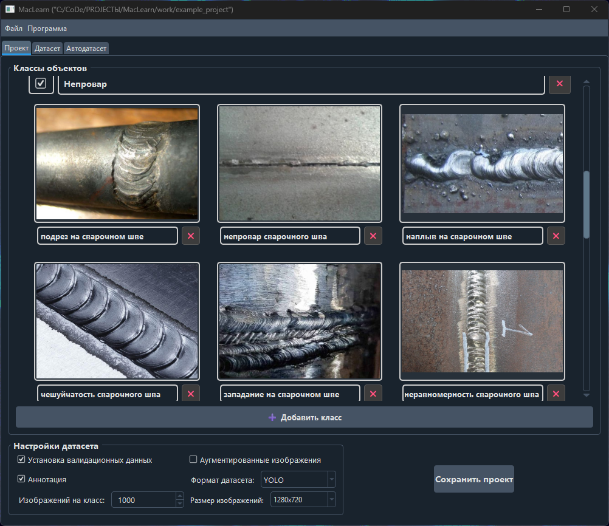
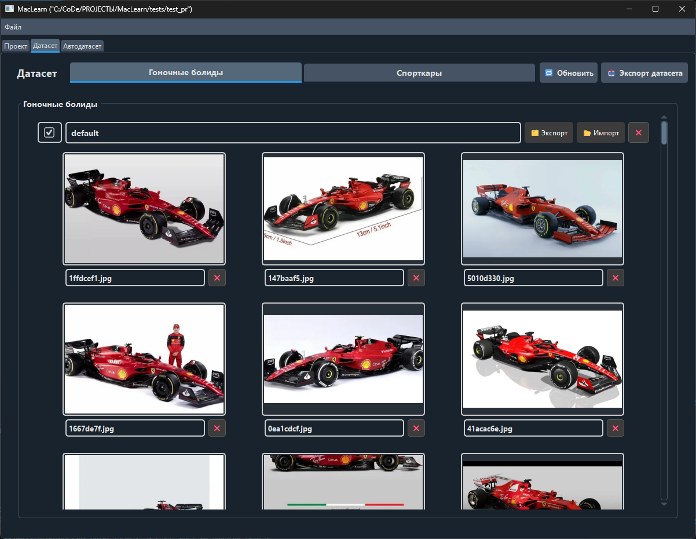
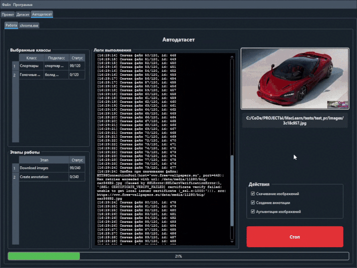

# MacLearn

<div align="center">


**Автоматический сбор и подготовка качественных датасетов из изображений**

[Скачать](https://github.com/b1t0nese/MacLearn/releases) · [Документация](https://github.com/b1t0nese/MacLearn/blob/main/doc/documentation.md) · [Документация кода](https://github.com/b1t0nese/MacLearn/blob/main/src/readme.md)

⭐ Если MacLearn оказался полезным — поставьте звезду на GitHub.

</div>

---

> MacLearn — это единая среда для ML-разработчиков и исследователей, которая объединяет парсинг изображений, автоаннотацию, аугментацию и экспорт в один рабочий процесс. Вместо разрозненных инструментов и ручной разметки — один интерфейс от сбора данных до готового датасета.

---

## ✨ Возможности

| Возможность | Описание |
|---|---|
| 🚀 **Быстрый сбор данных** | Тысячи изображений за часы, полный датасет на 5000+ изображений за день. Фильтрация дубликатов URL, автоматическая загрузка и обработка. |
| 🎯 **Качественная разметка** | Структуризация по классам и подклассам, автоматические bounding boxes, аннотация через **SAM3** с текстовыми промптами. |
| ✏️ **Ручной редактор аннотаций** | Графический редактор bounding boxes: перетаскивание, рисование, таблица координат, навигация по изображениям класса. |
| 🤖 **Автоматическая аугментация** | Генерация N вариаций каждого изображения: повороты, отражения, сдвиги, шум, размытие, цветокоррекция. Аннотации сохраняются при трансформации, вероятности настраиваются. |
| 📊 **Статистика датасета** | Встроенное окно статистики: баланс классов, разрешения, форматы, размеры, детали аннотаций и конфигурации проекта. |
| 📝 **Профессиональное логирование** | Цветной вывод в консоль, файловые логи с ротацией (10 MB, 5 backups), трассировка вызовов, тайминги, дублирование в UI, глобальный перехват исключений. |
| ⚙️ **Гибкие настройки** | Окно настроек по вкладкам: Chrome/сессии браузера, SAM3 (устройство, порог, веса), пресет аугментаций, язык. Параметры запуска (CLI) с приоритетом над настройками. |
| 🌍 **Мультиязычность** | Переводы интерфейса из JSON-файлов (`translations/*.json`), переключение на лету из меню; новый язык добавляется без правок кода. |
| 🖥️ **Удобный интерфейс** | Подготовка и обработка данных с визуализацией, импорт/экспорт по классам, встроенный Chrome, drag & drop карточек и файлов (в том числе между окнами и из проводника), горячие клавиши в каждом окне с подсказками. |
| 🗂️ **Проекты** | Файл проекта (`.maclproj`, zip-архив), папка проекта на диске, хранение метаданных в **SQLite**. |

---

## 🚀 Быстрый старт

### Требования

- **Python 3.12+**
- **Google Chrome** *(последняя версия, необходим для установки изображений)*

> [!WARNING]
> Если браузер не появляется в программе — скорее всего, установлена старая версия Chrome или он отсутствует. Временное решение: запустить программу с атрибутом `--chrome-version 1xx`.

### Установка из исходников

```bash
python -m pip install -r src/requirements.txt
```

### Запуск

```bash
python src/main.py
```

### Сборка

Релизы собираются автоматически: **GitHub Actions** собирает macOS (.dmg) и Windows (.exe) при пуше тега `vX.Y.Z` (или `X.Y.Z`) и прикладывает их к Release.

Локальная сборка (на выбор):

```bash
# PyInstaller (быстро, как в CI)
./scripts/build_macos\(pyinstaller\).sh
./scripts/build_windows\(pyinstaller\).sh

# Nuitka (компиляция в C)
./scripts/build_macos\(nuitka\).sh
./scripts/build_windows\(nuitka\).sh
```

<details>
<summary>📦 Детали сборки</summary>

- macOS: `dist/MacLearn.app` (PyInstaller) / `build/MacLearn.app` (Nuitka) → `MacLearn.dmg`
- Windows: standalone `dist/MacLearn.exe` (PyInstaller) / `build/MacLearn.dist/MacLearn.exe` (Nuitka)
- Точные версии зависимостей для сборки зафиксированы в `src/requirements.lock` (CI ставит из него)
- Версия тега записывается в бандл (`version.txt`) и видна в заголовке окна
- Модель `sam3.pt` **не включается** в приложение и загружается отдельно в каталог данных MacLearn
- Размер сборки определяется PyTorch, torchvision и OpenCV (необходимы для SAM3-аннотации)
- После сборки скрипты выводят 20 крупнейших файлов для анализа занимаемого места

</details>

---

## 📸 Скриншоты

| Настройка проекта | Работа с датасетом |
|---|---|
|  |  |

**Автоматический сбор в действии:**



---

## ❓ Почему MacLearn

| Проблема | Решение MacLearn |
|---|---|
| Сбор изображений вручную занимает недели | **Автоматический парсинг** за пару часов |
| Разметка тысяч файлов — это боль | **Автоаннотация** по примерам и SAM3 |
| Аугментацию нужно делать отдельно | **Встроенная генерация** +N вариаций |
| Форматы постоянно меняются | **Экспорт в один клик** (YOLO, CSV и др.) |
| Ошибки невозможно отследить | **Профессиональное логирование** каждой операции |

### Сравнение с аналогами

| Критерий | MacLearn | Ручные инструменты (LabelImg, CVAT, Roboflow) | Выигрыш |
|---|---|---|---|
| **Сбор изображений** | 🚀 Автоматический: по текстовым запросам, по фото-примерам, через браузер | 🔧 Ручной: поиск, скачивание по одному, копирование файлов | **10–100× быстрее** |
| **Разметка** | 🤖 Автоматическая / полуавтоматическая: bounding boxes, SAM3 с текстовыми промптами, трансфер разметки | ✍️ Полностью ручная: рисование рамок мышкой, ввод координат | **5–50× быстрее** |
| **Экспорт** | 📦 One-click: YOLO, CSV, кастомные форматы | 🧩 Конвертация скриптами, потеря данных, ручное редактирование JSON | **Без потерь, мгновенно** |
| **Настройка** | 🎛️ UI с параметрами, сохранение пресетов, предпросмотр | 📝 Редактирование JSON/YAML, ошибки синтаксиса | **Визуально и безопасно** |
| **Качество данных** | 🔍 Автоконтроль: дубликаты, артефакты, балансировка классов, статистика | 👁️ Визуальная проверка: пропуск ошибок, несбалансированные классы | **Системный подход** |
| **Интерфейс** | 🖥️ Единая среда: все этапы в одном окне, встроенный Chrome | 🧩 Разрозненные инструменты: браузер → редактор → конвертер | **Целостный workflow** |

---

## 🏗️ Технологический стек

| Слой | Технология |
|---|---|
| Язык | Python 3.12+ |
| GUI | PySide6 (Qt 6) |
| Браузер | Google Chrome |
| Аннотация | SAM3 (Segment Anything Model 3) |
| Хранение метаданных | SQLite |
| Формат проекта | `.maclproj` (zip-архив) |
| Сборка | Nuitka |

---

## 📄 Лицензия

Проект распространяется под лицензией **GPL-3.0**. Вы можете свободно использовать, модифицировать и распространять программу с сохранением авторских прав.

---

<div align="center">

**Разработчик: she1kah (Минибаев Артём)**

[GitHub](https://github.com/b1t0nese/MacLearn) · [Релизы](https://github.com/b1t0nese/MacLearn/releases) · [Документация](https://github.com/b1t0nese/MacLearn/blob/main/doc/documentation.md)

</div>