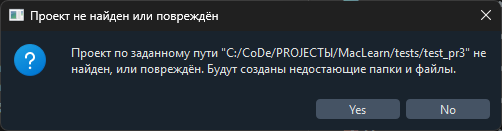
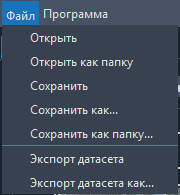
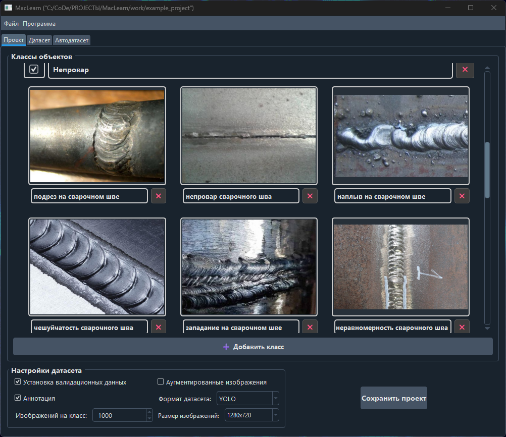
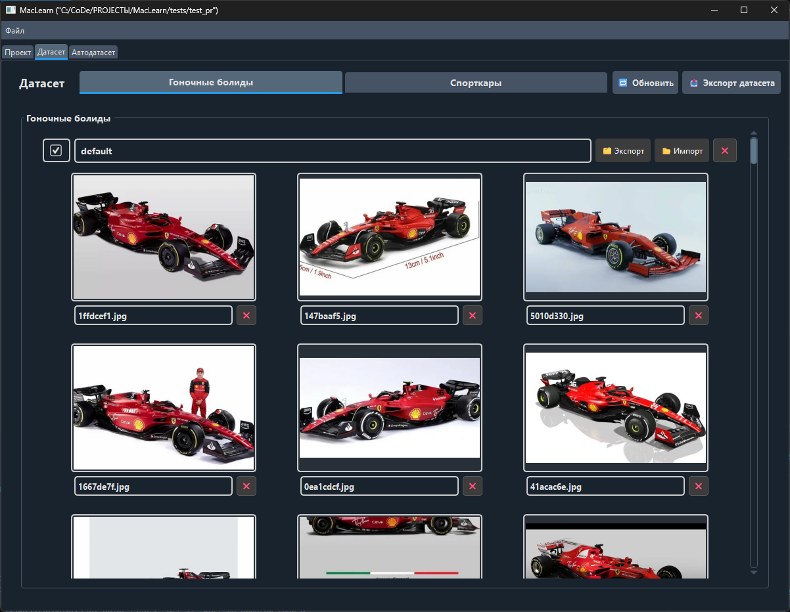
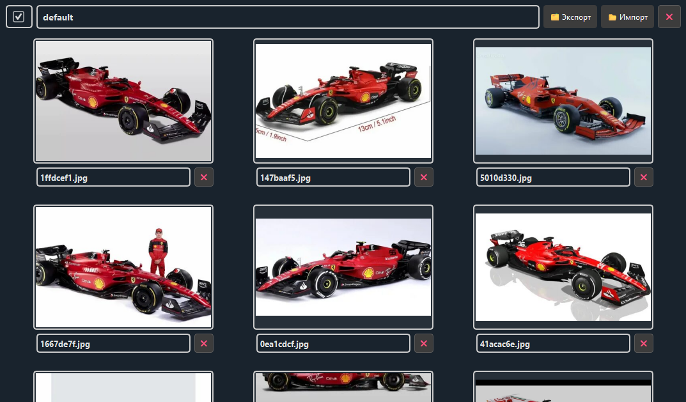
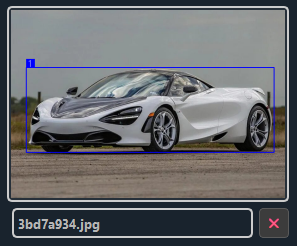
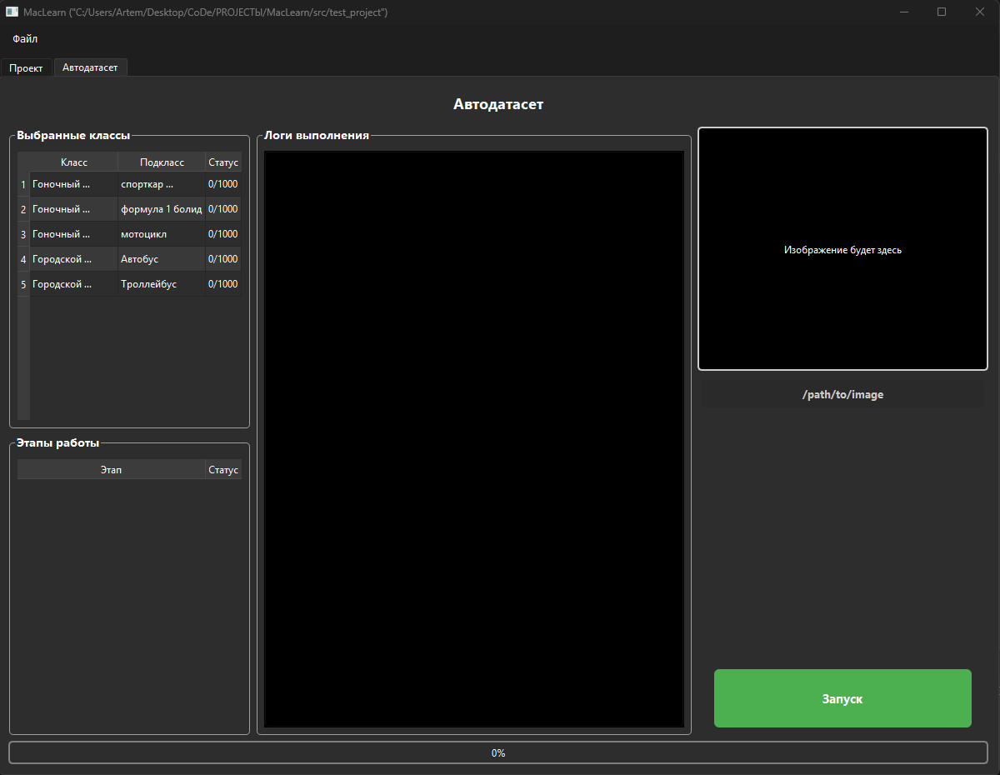
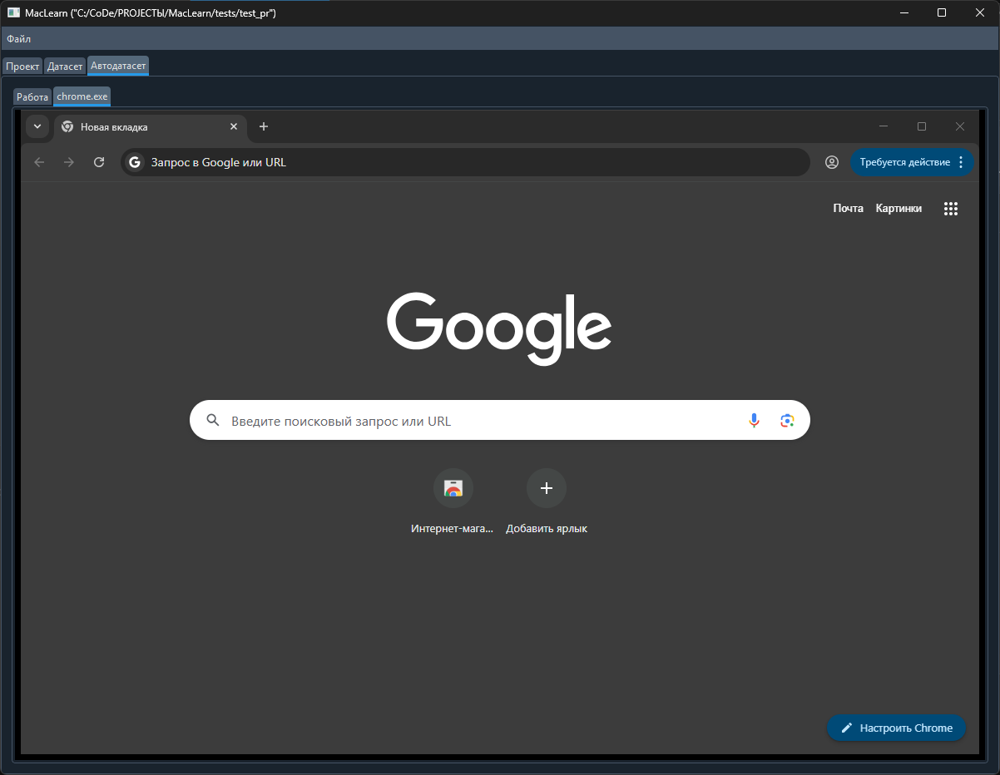

# MacLearn — документация | [Документация по коду](https://github.com/b1t0nese/MacLearn/blob/main/src/readme.md)

MacLearn — это программа для автоматического сбора и подготовки качественных датасетов из изображений, скачиваемых из интернета. Инструмент предназначен для ML-разработчиков, исследователей и всех, кто работает с компьютерным зрением.

---

## Оглавление

1. [Установка и первый запуск](#1-установка-и-первый-запуск)
2. [Сборка из исходников](#2-сборка-из-исходников)
3. [Параметры запуска](#3-параметры-запуска)
4. [Интерфейс](#4-интерфейс)
   - [Меню «Файл»](#меню-файл)
   - [Меню «Программа»](#меню-программа)
   - [Вкладка «Проект»](#вкладка-проект)
   - [Вкладка «Датасет»](#вкладка-датасет)
   - [Редактор изображений](#редактор-изображений)
   - [Вкладка «Автодатасет»](#вкладка-автодатасет)
   - [Статистика датасета](#статистика-датасета)
   - [Drag & drop](#drag--drop)
5. [Окно настроек](#5-окно-настроек)
6. [Язык интерфейса и переводы](#6-язык-интерфейса-и-переводы)
7. [Горячие клавиши](#7-горячие-клавиши)
8. [Логирование](#8-логирование)
9. [Данные приложения](#9-данные-приложения)
10. [Советы по использованию](#10-советы-по-использованию)
11. [Лицензия](#11-лицензия)

---

## 1. Установка и первый запуск

Установите зависимости из общего файла:

```bash
python -m pip install -r src/requirements.txt
```

1. **Запустите программу** — без `--project-path` откроется диалог создания нового проекта.
   Для открытия существующего проекта передайте его путь через `--project-path`.
2. Если появится окно с вопросом:

   

   Нажмите **«Да»**, если уверены, что выбрали нужную папку.
3. Откроется окно проекта. Настраивайте проект с помощью функций, описанных ниже.
4. Для запуска автоматического сбора перейдите во вкладку **«Автодатасет»** и нажмите **«Запуск»**.

---

## 2. Сборка из исходников

Требования:
- **Python 3.12+**
- **Chrome** (последняя версия)
- Visual C++ Redistributable (для standalone-сборки)

> **Релизы собираются автоматически**: GitHub Actions собирает macOS (.dmg) и Windows (.exe)
> при пуше тега `vX.Y.Z` (или `X.Y.Z`) и прикладывает их к Release. Точные версии зависимостей
> для сборки зафиксированы в `src/requirements.lock`; версия тега записывается в бандл и
> отображается в заголовке окна.

Скрипты сборки (на выбор):

```bash
# PyInstaller (быстро, как в CI)
./scripts/build_macos\(pyinstaller\).sh
./scripts/build_windows\(pyinstaller\).sh

# Nuitka (компиляция в C)
./scripts/build_macos\(nuitka\).sh
./scripts/build_windows\(nuitka\).sh
```

### Windows

```bash
./scripts/build_windows\(nuitka\).sh
```

Что делает скрипт:
1. Создаёт чистое виртуальное окружение `build_env`
2. Устанавливает все зависимости из `../src/requirements.txt`
3. Компилирует `MacLearn.exe` через **Nuitka** (standalone mode)
4. Если UPX установлен и доступен в `PATH`, выполняет сжатие `.exe`, `.dll` и `.pyd`

### macOS

```bash
./scripts/build_macos\(nuitka\).sh
```

Скрипт создаёт виртуальное окружение, устанавливает зависимости из
`src/requirements.txt` и собирает `build/MacLearn.app` через Nuitka с плагином
PySide6. Для работы сбора изображений Google Chrome устанавливается отдельно.
Основной размер приложения дают PyTorch, torchvision и OpenCV, необходимые для SAM3;
веса `sam3.pt` в приложение не включаются. Скрипт выводит крупнейшие файлы сборки
для диагностики её размера.

---

## 3. Параметры запуска

| Аргумент | Описание |
|----------|----------|
| `--project-path PATH` | Путь к проекту: `.maclproj` (zip) или папка |
| `--chrome-version VERSION` | Версия Chrome, если автоопределение не сработало |
| `--chromedriver-path PATH` | Путь к собственному chromedriver |
| `--chrome-no-headless` | Показать окно Chrome; по умолчанию Chrome запускается в headless-режиме |
| `--chrome-session NAME` | Имя сессии браузера — отдельный профиль, cookies и кэш на сессию |
| `--language ru\|en` | Язык интерфейса; сохраняется в настройки (см. [раздел 6](#6-язык-интерфейса-и-переводы)) |
| `--log-level DEBUG\|INFO\|WARNING\|ERROR` | Уровень логов в консоли (в файл пишется всегда всё) |

Аргументы имеют приоритет над настройками из окна настроек: параметры Chrome
берутся из CLI, если они переданы, иначе — из сохранённых настроек.

---

## 4. Интерфейс

### Меню «Файл»



- **«Новый проект»** — создать временный проект без выбора папки; путь сохранения
  запрашивается при закрытии, если выбрать сохранение изменений.
- **«Открыть»** — открыть существующий проект `.maclproj` (zip). При выборе программа перезапускается с новым проектом.
- **«Открыть как папку»** — выбрать папку проекта (не архив).
- **«Сохранить»** — сохранить конфигурацию автоматизации (аналог кнопки «Сохранить проект» во вкладке «Проект»).
- **«Сохранить как...»** — сохранить проект как `.maclproj` (zip) с возможностью сразу перезапустить программу.
- **«Сохранить как папку...»** — сохранить проект в виде папки.
- **«Экспорт датасета как...»** — экспортировать датасет по указанному пользователем пути.
- **«Перезапустить»** — полный перезапуск программы с текущим проектом.
- **«Новое окно»** — открыть новое независимое окно приложения.
- **«Выход»** — закрыть программу.
- **«О программе»** — открыть страницу репозитория MacLearn.

### Меню «Программа»

- **«Настройки»** — открыть окно настроек ([раздел 5](#5-окно-настроек)).
- **«Язык / Language»** — переключение языка интерфейса на лету ([раздел 6](#6-язык-интерфейса-и-переводы)).
- **«Перезапустить»**, **«Новое окно»**, **«Выход»**, **«О программе»** — см. меню «Файл».

### Вкладка «Проект»



#### Раздел «Классы объектов»

- **Навигация по классам** — выбор класса в табе сверху.
- **Поиск поисковых запросов** — можно вписать текст, по которому будут искаться подклассы.
- **Вкл./выкл. класса** — включает или исключает класс из работы автодатасета.
- **Изменение названия класса** — название используется как идентификатор в базе данных.
- **Добавление класса** — кнопка снизу поля.
- **Удаление класса** — удалить выбранный класс.
- **Изменение порядка классов** — перетащите поле класса на другое поле: классы поменяются местами по порядку.

##### Подклассы

- **Поле с изображением** — можно выбрать изображение-пример кликом или перетащить файл на карточку.
- **Текст для поиска** — поисковый запрос для данного подкласса.
- **Удаление подкласса** — удалить подкласс.
- **Перенос подкласса** — перетащите карточку на поле другого класса; если там уже есть подкласс с тем же запросом, карточки объединятся.

#### Раздел «Настройки датасета»

- **«Создание валидационных данных»** — скачивать дополнительные изображения для валидации (≈20% от целевого количества).
- **«Аугментированные изображения» — количество** — сколько вариаций генерировать для каждого изображения.
- **«Аннотация»** — включить автоматическое выделение объектов на изображениях через SAM3.
- **«Формат аннотации»** — выбор формата экспорта датасета: **YOLO**, **CSV** и др.
- **«Изображений на класс»** — количество изображений для каждого класса.
- **«Размер изображений»** — выбор размера выходных изображений при экспорте.

### Вкладка «Датасет»



#### Основные функции
- **«Обновление данных»** — синхронизация с файловой системой.
- **«Экспорт датасета»** — выгрузить датасет по выбранному пути.
- **«Выбор класса»** — переключение между классами в TabBar.
- **Навигация по разделам изображений** — переключение между типами: **default**, **augment**, **validation**.
- **Поиск изображений** — можно вписать текст, по которому будут искаться изображения.
- **Клик по названию «Датасет»** — открыть окно статистики датасета.

#### Виджеты

##### Поле изображений «для типов»



- **«Экспорт изображений поля»** — выгрузить изображения текущего поля.
- **«Импорт изображений в поле»** — загрузить изображения из папки.
- **«Удаление изображений»** — удалить все изображения данного типа.
- **«+»** — добавить одно изображение в проект.

##### Карта изображения



- **Изображение** — показывает фото; если есть аннотация — рисуются bounding boxes.
- **Клик по изображению** — открыть [редактор изображений](#редактор-изображений).
- **«Удалить»** — удалить конкретное изображение.

### Редактор изображений

Открывается кликом по карте изображения во вкладке «Датасет». Позволяет вручную исправить и дорисовать аннотации:

- **Режим «Перемещение»** — тянуть готовую рамку мышью, чтобы сдвинуть её.
- **Режим «Изменение расположения»** — нарисовать рамку заново поверх существующей или добавить новую на пустом месте.
- **Таблица аннотаций** (`class/x/y/w/h`) — координаты редактируются двойным кликом и синхронизируются с картинкой; кнопки «+/−» добавляют и удаляют рамки.
- **Выпадающий список классов** — назначает класс выбранной рамке.
- **Кнопки «‹» и «›»** — переход к предыдущему/следующему изображению этого же класса и типа.
- Изменения сохраняются автоматически при закрытии окна и при переходе между изображениями.

### Вкладка «Автодатасет»




#### Виджеты

- **Вкладки «Работа» и «chrome.exe»** — вторая вкладка позволяет поместить окно браузера внутрь программы. Chrome запускается лениво: вкладка появляется при первом запуске сбора данных (а не при старте программы). Встраивание окна доступно в Windows и в Linux (X11, при установленном `xdotool`); в macOS окно браузера открывается отдельным окном.
- **«Выбранные классы»** — таблица со статусами установки изображений по подклассам.
- **«Этапы работы»** — статусы этапов: скачивание, аннотация, аугментация.
- **«Логи выполнения»** — подробный текстовый вывод всех операций.
- **Превью изображения** — последнее обработанное изображение и его путь.
- **Кнопка «Запуск/Стоп»** — запуск и остановка процесса.
- **Прогрессбар** — общий процент выполнения.

#### Этапы работы

1. **Download images** — поиск в Яндекс.Картинках по тексту или фото-примеру; содержимое изображения извлекается из браузера и сразу сохраняется в проект.
2. **Create annotation** — автоматическое создание bounding boxes через SAM3.
3. **Create augmentation data** — генерация вариаций с переносом аннотаций.

### Статистика датасета

Окно статистики (клик по заголовку «Датасет» во вкладке «Датасет») показывает:

| Раздел | Содержимое |
|--------|-----------|
| **Общая информация** | путь проекта, размер БД |
| **Изображения** | количество, размер, форматы, среднее разрешение |
| **Аннотации** | всего, среднее/макс/мин на изображение, медиана |
| **Классы** | количество, баланс, детали по каждому классу |
| **Качество и свойства** | целостность данных, производные изображения |
| **Конфигурация проекта** | формат, аугментация, валидация, размеры |

### Drag & drop

Перетаскивание работает внутри окна, между вкладками и между разными окнами/экземплярами программы, а также из проводника (Finder):

| Откуда | Куда | Результат |
|--------|------|-----------|
| Карточка подкласса («Проект») | Поле другого класса | Подкласс переедет; при совпадении поискового запроса карточки объединятся |
| Поле класса («Проект») | Другое поле класса | Классы поменяются порядком |
| Карточка изображения («Датасет») | Поле другого класса/типа | Изображение перенесётся в БД (класс и/или тип изменятся) |
| Карточка изображения («Датасет») | Вкладка другого класса | После короткого наведения вкладка откроется — можно продолжить драг и положить изображение в нужное поле |
| Файл из проводника | Карточка подкласса | Файл станет изображением-примером подкласса |
| Файл из проводника | Поле изображений («Датасет») | Файлы импортируются в датасет |

---

## 5. Окно настроек

Открывается из меню «Программа» → «Настройки». Настройки хранятся вне проекта и применяются ко всем проектам. Изменения применяются сразу после нажатия «Сохранить» (без перезапуска программы), где это возможно.

| Вкладка | Параметры |
|---------|-----------|
| **Интерфейс** | Язык интерфейса |
| **Chrome** | Путь к chromedriver, версия Chrome (0 — авто), имя сессии браузера, показ окна Chrome |
| **Аннотации (SAM3)** | Устройство (`cpu`/`cuda`/`mps`), порог уверенности, мин. площадь бокса, путь к весам `sam3.pt`, одно обнаружение на класс |
| **Аугментация (Albumentations)** | Вероятности трансформаций: crop, отражения, поворот 90°, сдвиг/масштаб/поворот, цветокоррекция, шум, размытие |

Настройки Chrome и SAM3 используются автодатасетом при запуске сбора; настройки проекта
(количество изображений, формат и т.д.) по-прежнему задаются во вкладке «Проект» и имеют приоритет.

---

## 6. Язык интерфейса и переводы

Язык выбирается в меню «Программа» → «Язык / Language» или в окне настроек; выбор сохраняется и применяется сразу. Русский — исходный язык интерфейса.

Переводы хранятся в JSON-файлах `src/interface_module/translations/<код>.json`:

```json
{
    "name": "English",
    "translations": {
        "Файл": "File",
        "Сохранить": "Save"
    }
}
```

Добавить новый язык можно без правок кода: положите рядом файл `<код>.json` с полем `name` и словарём переводов — язык появится в меню автоматически. Файлы переводов включаются в сборки (Nuitka `--include-data-dir`).

---

## 7. Горячие клавиши

- **Кнопки окон** — каждой кнопке автоматически назначается «голая» клавиша (первая свободная буква из её названия, например `[З]` для «Запуск»). Нажатие клавиши равносильно клику. Подсказка показывается в tooltip кнопки.
- **Пункты меню** — сочетания `Ctrl+<буква>` (например, `Ctrl+S` для «Сохранить»).
- Клавиши не срабатывают, пока фокус в поле ввода (текст, комбобокс, спинбокс) — обычный набор текста не конфликтует с кнопками.
- У каждого окна свой независимый набор клавиш.

---

## 8. Логирование

MacLearn имеет встроенную систему логирования (`src/logger.py`):

### Возможности
- **Цветной вывод в консоль** (stderr) с эмодзи-статусами
- **Автоматическая запись в файл**
- **Трассировка вызовов** — вход/выход функций, аргументы, время выполнения
- **Тайминги** операций через `@log_timing()` и `LogContext`
- **Сессии** — старт/стоп приложения с параметрами
- **Глобальный хук** исключений — все unhandled errors логируются
- **UI-интеграция** — окна логов приложения автоматически подключаются к системе и показывают те же сообщения

### Формат файлового лога
```
[2025-08-11 13:31:00] [INFO] [main] ▶ Application starting...
[2025-08-11 13:31:01] [INFO] [autodataset] ✓ Chrome driver started (PID=12345)
[2025-08-11 13:31:02] [ERROR] [main] ✗ Critical error: ...
```

Логи хранятся в папке данных приложения: `%APPDATA%/maclearn/logs/` (Windows), `~/Library/Application Support/maclearn/logs/` (macOS), `~/.config/maclearn/logs/` (Linux).

Уровень логов в консоли меняется аргументом `--log-level`; в файл всегда пишется максимум деталей.
При включённой аннотации веса SAM3 автоматически загружаются при первом запуске
и сохраняются в `models/sam3.pt` внутри папки данных приложения (путь можно изменить в настройках).

---

## 9. Данные приложения

Всё, что программа хранит вне папки проекта, лежит в папке данных приложения (`%APPDATA%/maclearn` в Windows, `~/Library/Application Support/maclearn` в macOS, `~/.config/maclearn` в Linux):

| Путь | Содержимое |
|------|------------|
| `settings.json` | Настройки приложения: язык, Chrome, SAM3, пресет аугментаций |
| `logs/` | Логи приложения (с ротацией) |
| `chromedriver.exe` | Кэшированный драйвер Chrome (скачивается один раз) |
| `cache/browser_sessions/<сессия>/` | Профиль браузера: cookies, сессии сайтов, disk cache |
| `cache/webdriver_manager/` | Кэш скачанных файлов `webdriver_manager` |
| `models/sam3.pt` | Веса SAM3 (скачиваются при первой аннотации) |

Профиль браузера хранится между запусками, поэтому авторизация и настройки сайтов сохраняются.
Разные сессии (`--chrome-session`, настройки) дают независимые профили.
Удаление этих папок безопасно — они создадутся заново.

> **macOS и Chrome.** Скачанный `chromedriver` патчится `undetected_chromedriver` и переподписывается
> ad-hoc подписью (`codesign`). Без этого macOS завершает драйвер сигналом `SIGKILL` (код `-9`), и Chrome
> не запускается. Если Chrome всё равно не стартует, удалите `chromedriver` из папки данных — он
> скачается заново и будет подготовлен автоматически.

---

## 10. Советы по использованию

- Не изменяйте вручную содержимое папки проекта. Все операции — только через программу.
- Сохраняйте настройки проекта после изменений.
- Используйте вкладку **«chrome.exe»**, чтобы окно браузера не мешалось на рабочем столе.
- Исправляйте неточные аннотации в [редакторе изображений](#редактор-изображений) перед экспортом.
- Будьте внимательны: функции отмены (Ctrl+Z) в программе нет.
- Проверяйте логи в папке данных приложения (`%APPDATA%/maclearn/logs/` в Windows) при возникновении ошибок — там будет подробная информация.

---

## 11. Лицензия

### Проект защищён лицензией [GPL-3.0 license](https://github.com/b1t0nese/MacLearn/blob/main/LICENSE)
